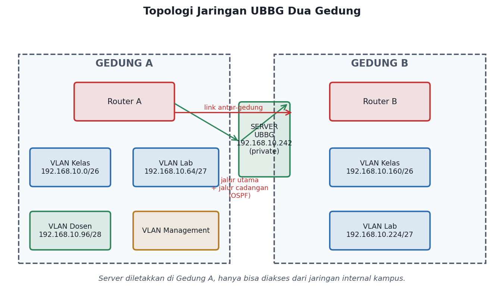
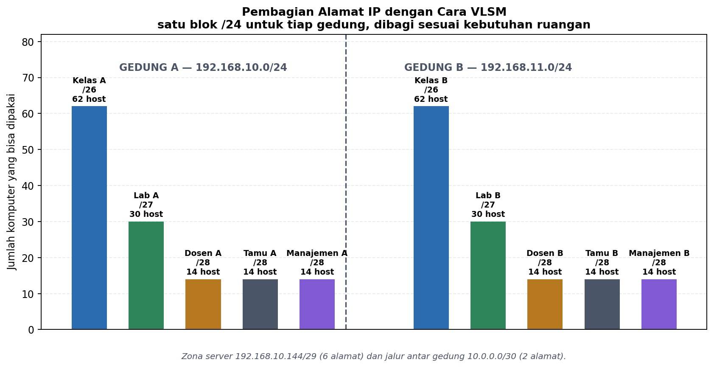

# Rancang Bangun Jaringan UBBG Dua Gedung — VLAN, Inter-VLAN Routing, Pembatasan Akses, dan Jalur Cadangan

**Mata kuliah:** Pemodelan Komunikasi Data dan Jaringan (MKKL1031) · Semester 7
**Program Studi Ilmu Komputer — Fakultas Sains, Teknologi dan Ilmu Kesehatan**
**Universitas Bina Bangsa Getsempena**
**Dosen Pengampu:** Ahmad Mujahid Abdurrahman, S.Kom, M.T.

Rancangan dan simulasi jaringan yang menghubungkan dua gedung kuliah UBBG. Server kampus yang menyimpan data penting diletakkan di Gedung A dan hanya boleh diakses dari jaringan internal — jaringan tamu ditolak. Jaringan dipisah per keperluan memakai VLAN, dihubungkan dengan inter-VLAN routing, dan kedua gedung disambung dua jalur supaya jaringan tetap jalan saat jalur utama terputus. Seluruh rancangan dijalankan dan diuji di Cisco Packet Tracer.

## Anggota Kelompok

| No | Nama | NIM | Peran |
|---|---|---|---|
| 1 | Paris Mursidan Aufal | 23210125 | Skema pengalamatan VLSM kedua gedung dan tabel pengalamatan |
| 2 | Yogi Prasetya Sadewa | 23210060 | Ketua kelompok; perancangan topologi, konfigurasi server, dan integrasi simulasi |
| 3 | M. Sidiq Prasetio | 23210075 | Konfigurasi VLAN dan inter-VLAN routing pada switch lapis tiga |
| 4 | Deski Taiza | 23210003 | Routing dinamis antar-gedung (OSPF) dan jalur cadangan |
| 5 | Wira | 23210045 | Aturan pembatasan akses ke server dan pengujian konektivitas |
| 6 | T. Zain Wardana | 23210001 | Pengujian di Packet Tracer dan penyusunan tabel bukti |

> Kelompok berjumlah 6 orang; setiap anggota mengerjakan satu bagian di tiap mata
> kuliah dan melakukan commit dari akun GitHub masing-masing.

## Rencana Proyek

- Google Docs (dibagikan kepada dosen dengan akses komentar) — tautan: [MKKL1031 — Jaringan UBBG Dua Gedung](https://docs.google.com/document/d/1krusm61k6EZOCbH7tlWy59acsWTg5411hK5TJ2IUZFU/edit)
- Salinan di repository: [`docs/rencana-proyek.md`](docs/rencana-proyek.md)

## Topologi



Kedua gedung dihubungkan **dua jalur**: jalur utama `10.0.0.0/30` dan jalur
cadangan `172.16.30.0/30`.

> **Catatan tentang gambar di atas:** diagram ini diambil dari dokumen proposal
> dan masih menggambarkan 4 PC per gedung. Topologi yang benar-benar dibangun di
> simulasi lebih besar — **8 PC per gedung (16 total)**. Jumlah VLAN, alamat,
> dan jalurnya tetap sama. Diagram yang persis sama dengan simulasi dapat
> diperoleh dengan membuka berkas `.pkt` langsung.
>
> Perbedaan lain: gambar menuliskan switch sebagai `2950-24`, sedangkan yang
> dipakai pada simulasi adalah `2960-24TT`.

Nilai tengah gambar untuk pembagian alamat:



## Cara Menjalankan

### Kebutuhan

- Cisco Packet Tracer (diuji pada versi 9.0) untuk membuka berkas simulasi
- Alternatif: GNS3 atau Mininet, dengan catatan konfigurasi perlu penyesuaian

### 1. Membuka simulasi

Buka berkas di folder `simulation/` menggunakan Packet Tracer, lalu tunggu
seluruh perangkat selesai memuat konfigurasi (biasanya 1–2 menit).

### 2. Memeriksa pengalamatan

Pada setiap PC, buka **Desktop > Command Prompt** dan jalankan:

```
ipconfig /all
```

Alamat yang muncul harus sesuai tabel pada `docs/pengalamatan-vlsm.md`.
Alamat penting yang dipakai pada langkah berikutnya:

| Perangkat | Alamat |
|---|---|
| Gerbang VLAN 10 (Kelas, Gedung A) | 192.168.10.1 |
| Gerbang VLAN 20 (Laboratorium, Gedung A) | 192.168.10.65 |
| Gerbang VLAN 99 (Tamu, Gedung A) | 192.168.10.113 |
| Gerbang VLAN 11 (Kelas, Gedung B) | 192.168.11.1 |
| Server UBBG | 192.168.10.146 |

### 3. Menguji konektivitas antar-VLAN

Dari PC pada VLAN 10:

```
ping 192.168.10.1        # gerbang VLAN sendiri
ping 192.168.10.65       # VLAN lain di gedung yang sama
ping 192.168.11.10       # PC di gedung lain
ping 192.168.10.146      # Server UBBG
```

### 4. Menguji pembatasan akses tamu

Dari PC pada VLAN 99 (tamu), `ping 192.168.10.146` **harus gagal**. Dari PC
internal pada VLAN yang sama-sama mengarah ke server, ping **harus berhasil**.
Selisih hasil inilah yang membuktikan ACL bekerja.

### 5. Menguji jalur cadangan

Putuskan jalur utama (matikan `GigabitEthernet0/1` di R-GEDUNG-A), lalu ulangi
ping antar-gedung dari PC0 ke PC8. Koneksi harus tetap jalan. Waktu perpindahan
dicatat pada `docs/pengujian.md`.

## Struktur Repository

```
pkdj_2026_kelompok1_rancang_bangun_jaringan_ubbg/
├── README.md
├── docs/
│   ├── rencana-proyek.md
│   ├── pengalamatan-vlsm.md
│   ├── konfigurasi.md
│   ├── pengujian.md
│   └── gambar/
├── simulation/
│   ├── README.md
│   └── jaringan-ubbg-dua-gedung.pkt   # berkas Cisco Packet Tracer
└── src/
    └── configs/               # salinan konfigurasi tiap perangkat
```

## Dokumentasi

| Berkas | Isi |
|---|---|
| `docs/rencana-proyek.md` | Rencana proyek, target UTS dan UAS, pembagian kerja per minggu, risiko |
| `docs/pengalamatan-vlsm.md` | Tabel VLSM: alamat jaringan, alamat broadcast, dan rentang host per VLAN |
| `docs/konfigurasi.md` | Konfigurasi router, multilayer switch, access switch, dan server |
| `docs/pengujian.md` | Skenario pengujian dan tabel bukti konektivitas |
| `src/configs/` | Salinan `show running-config` tiap perangkat |

## Status Pengujian

Delapan skenario dari proposal sudah dijalankan. Tujuh terbukti, satu dilewati
karena keterbatasan simulasi.

| # | Skenario | Expected | Hasil | Status |
|---|---|---|---|---|
| 1 | Setiap PC memperoleh alamat sesuai tabel | Sesuai tabel | 16 PC terpasang alamat statis sesuai tabel | ✅ |
| 2 | Komunikasi antar-VLAN dalam satu gedung | Balasan | PC0 → PC3 balasan 100% | ✅ |
| 3 | PC Gedung B mengakses server Gedung A | Balasan | PC8 → 192.168.10.146 balasan 4/4 | ✅ |
| 4 | Portal web server dapat dibuka | Halaman terbuka | PC0 dan PC8 membuka `http://192.168.10.146` | ✅ |
| 5 | Tamu mengakses server | Ditolak | PC7 → server 0/4 (100% loss); PC0 → server 4/4 | ✅ |
| 6 | Tamu memakai internet | Berhasil | — | ⬜ dilewati (butuh ISP, di luar batasan simulasi) |
| 7 | Jalur utama putus, cadangan mengambil alih | Tetap tersambung | PC0 → PC8 tetap balasan 4/4 lewat jalur cadangan | ✅ |
| 8 | Waktu perpindahan ke jalur cadangan | Diukur | Rute berpindah dalam ~2,5 detik (3 percobaan: 2,4 s / 2,5 s / 2,5 s) | ✅ |

Tabel bukti lengkap beserta perintah pengujiannya ada di
[`docs/pengujian.md`](docs/pengujian.md).

## Pemenuhan Ketentuan Mata Kuliah

- **Topologi disimulasikan**: berkas `.pkt` tersimpan di `simulation/` dan sudah dijalankan.
- **Skema pengalamatan lengkap**: VLSM dengan tabel alamat jaringan, alamat broadcast, dan rentang host.
- **VLAN dan routing**: sembilan VLAN di dua gedung, inter-VLAN routing dijalankan, dan routing antar-gedung terpasang.
- **Pembatasan akses**: ACL menolak jaringan tamu menuju zona server, dibuktikan dua arah.
- **Jalur cadangan**: dua jalur antar-gedung dengan floating static, waktu perpindahan terukur.
- **Layanan server diuji**: portal web dibuka dari kedua gedung dan dari VLAN berbeda.

## Aturan Kerja Kelompok

- Commit dilakukan dari akun GitHub masing-masing anggota, bukan satu akun untuk seluruh kelompok.
- Pesan commit deskriptif dan menunjukkan kemajuan; dikerjakan minimal sekali per minggu per anggota.
- Pekerjaan bersama menggunakan branch dan pull request; pembagian tugas dicatat pada Issues.
- Kredensial, token, dan berkas `.env` tidak boleh masuk repository.

## Status

| Tahap | Target | Status |
|---|---|---|
| Pertemuan 2 | Rencana proyek, repository, undangan kolaborator | Selesai |
| Pertemuan 8 (UTS) | Topologi dasar terbentuk dan seluruh VLAN dikonfigurasi pada switch | Selesai |
| Pertemuan 16 (UAS) | Model jaringan lengkap dan dapat dijalankan pada perangkat lunak simulasi | Selesai — 7 dari 8 skenario terbukti |

Alamat di seluruh berkas sudah diperiksa konsisten dengan
[`docs/pengalamatan-vlsm.md`](docs/pengalamatan-vlsm.md).
