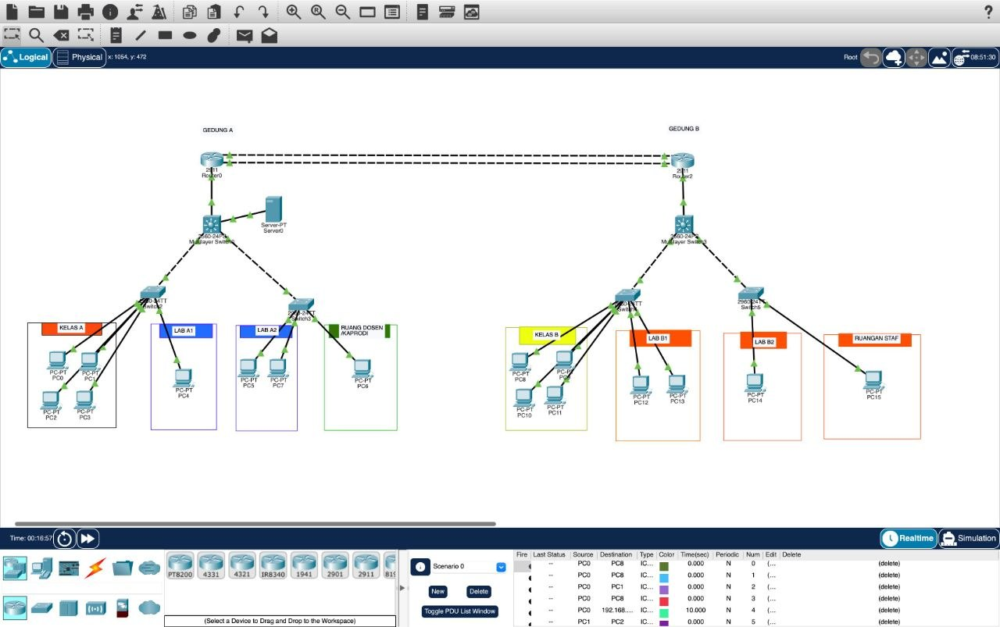

# Penjelasan Topologi Jaringan Gedung A dan Gedung B

## 1. Gambaran Umum

Topologi jaringan ini dirancang untuk menghubungkan dua gedung, yaitu Gedung A dan Gedung B. Setiap gedung memiliki router, multilayer switch, switch akses, serta komputer yang ditempatkan di beberapa ruangan. Gedung A juga memiliki sebuah server yang terhubung ke multilayer switch.

## 2. Perangkat Jaringan

- **Router:** Menghubungkan jaringan Gedung A dan Gedung B.
- **Multilayer switch:** Menghubungkan switch akses dan dapat melakukan routing jika dikonfigurasi.
- **Switch akses:** Menghubungkan komputer di setiap ruangan ke jaringan.
- **Server:** Menyediakan layanan jaringan untuk perangkat yang memiliki akses sesuai konfigurasi.
- **Komputer:** Digunakan oleh pengguna di kelas, laboratorium, ruang dosen, dan ruang staf.

## 3. Pembagian Area

**Gedung A** terdiri dari Kelas A, Lab A1, Lab A2, serta Ruang Dosen/Kaprodi. Server juga ditempatkan di gedung ini.

**Gedung B** terdiri dari Kelas B, Lab B1, Lab B2, serta Ruangan Staf.

## 4. Alur Komunikasi

Komputer terhubung ke switch akses di area masing-masing. Selanjutnya, koneksi diteruskan ke multilayer switch. Untuk berkomunikasi dengan jaringan di gedung lain, data diteruskan melalui router sesuai konfigurasi routing yang diterapkan.

## 5. Kesimpulan

Topologi ini menggunakan susunan jaringan bertingkat, mulai dari komputer, switch akses, multilayer switch, hingga router penghubung antargedung. Susunan ini membantu pengelolaan jaringan berdasarkan area dan ruangan. Fungsi routing, VLAN, dan redundansi bergantung pada konfigurasi perangkat yang digunakan.

## 6. Gambar Topologi

